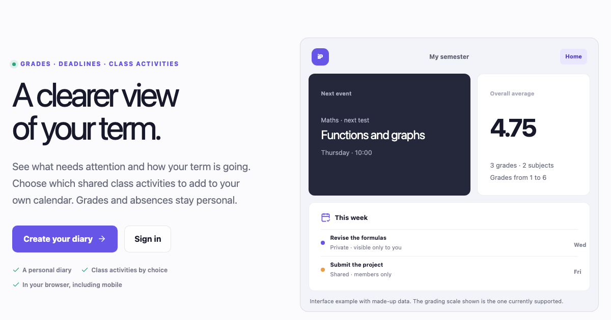

<p align="center">
  
</p>

<h1 align="center">iPagell</h1>

<p align="center">
  <strong>A personal school diary for grades, deadlines, absences and statistics.</strong><br>
  Installable, works offline, and keeps your grades private.
</p>

<p align="center">
  <a href="https://ipagell.website"><strong>Open the app</strong></a>
  ·
  <a href="#features">Features</a>
  ·
  <a href="#getting-started">Getting started</a>
  ·
  <a href="docs/README.md">Documentation</a>
  ·
  <a href="README.it.md">Italiano</a>
</p>

<p align="center">
  <a href="https://github.com/Ahmed-ali05/iPagell/actions/workflows/check.yml"></a>
  <a href="https://ipagell.website"></a>
  <a href="LICENSE"></a>
  
  
  
  
</p>

<p align="center">
  <a href="https://ipagell.website/en"></a>
</p>

> [!NOTE]
> iPagell is an independent project. It is not an official school register and is not affiliated with any school. The starter subjects are an optional, fully editable template.

## Why iPagell

School portals tell you what was recorded. iPagell helps you see what needs attention next: which subject is pulling your average down, what grade you need on the next test, and which deadlines are coming up this week. Grades and absences stay in your personal diary; class groups only share the activities you choose to follow.

## Features

| | |
|---|---|
| **Grades and averages** | Weights per grade and grade type, coefficients per subject, trends over time and a "what do I need next?" simulator. Uses a 1–6 scale (higher is better, 4 is a pass). |
| **Agenda** | Homework, tests and deadlines with filters, a weekly overview and reminders while the app is open. |
| **Absences and statistics** | Summaries by term and subject, with period, year and history views. |
| **Notes** | Per-subject notes with a visual editor, drafts saved on the device, sync across devices and PDF/Markdown export. |
| **Private classes** | Invite-only groups with roles and revocable codes. Members share activities and class notes, never grades or absences. |
| **Offline first** | A local copy in IndexedDB, an installable PWA shell and a JSON backup you can export and import at any time. |
| **Accounts and sync** | Email/password or Google sign-in, protected sessions and revision-based conflict detection. |
| **Four languages** | English, Italian, German and French. Your own content stays in the language you wrote it in. |
| **Free grade calculator** | A public weighted-average calculator that needs no account and stores nothing. |

## Tech stack

| Layer | Technology |
|---|---|
| UI | React 19, TypeScript, Tailwind CSS 4, Radix / shadcn components, Recharts |
| Framework | Next.js 16 built with [Vinext](https://github.com/cloudflare/vinext) and Vite |
| Backend | Cloudflare Workers, D1 (SQLite), Drizzle ORM, Zod validation |
| Offline | Service worker, IndexedDB, web app manifest |
| Editor and export | ProseMirror, pdf-lib |

## Getting started

**Requirements:** Node.js 22.23.4+, 24.22.1+ or 26.12.1+ (the version in `.nvmrc` is the default) and npm. Older and unsupported releases are rejected on purpose; see [runtime security](docs/RUNTIME-SECURITY-2026-10-22.md) for the reasons.

```bash
git clone https://github.com/Ahmed-ali05/iPagell.git
cd iPagell
nvm install && nvm use   # optional, picks the version from .nvmrc
npm run install:ci
npm run build
```

Initialise the local D1 database as described in the [maintenance guide](docs/MANUTENZIONE.md), then start the dev server:

```bash
npm run dev
```

### Checks

```bash
npm run check        # runtime, lint, types, tests, i18n and docs in one go
npm test             # unit and integration tests only
npm run test:api     # API smoke tests, local environment only
```

The API tests create synthetic accounts and data. Never run them against the production site.

## Project structure

```text
app/          Next.js routes: public pages, the diary app and API handlers
components/   UI components
lib/          Domain logic: grades, sync, auth, notes, i18n
db/           Drizzle schema         drizzle/   SQL migrations
public/       Icons, manifest, service worker, screenshots
tests/        Node test runner suites
scripts/      Build, deploy, inventory and check scripts
docs/         Architecture, API, operations and product docs
```

An [auto-generated inventory](docs/REPO-INVENTORY.md) lists every route, table, migration and npm script, and CI fails if it drifts from the source.

## Deployment

Production runs at **[ipagell.website](https://ipagell.website)** on a Cloudflare Worker with a D1 database in the EU jurisdiction. Releases are manual:

```bash
npx wrangler login
npm run release:prepare
npm run deploy:cloudflare
```

GitHub Actions runs the full check suite, a dependency audit and local D1 compatibility tests on every pull request and on `main`; it never deploys. See [development and deployment](docs/DEPLOYMENT.md) for staging, migrations and the release log.

## Documentation

Most of the technical documentation is written in Italian.

| Document | What it covers |
|---|---|
| [Documentation index](docs/README.md) | Map of current guides, specs and history |
| [User guide](docs/GUIDA-UTENTE.md) | Using the app, installing it, accounts, recovery and data |
| [Current architecture](docs/ARCHITECTURE-CURRENT.md) | Components, persistence, formulas and sync |
| [API contract](docs/API.md) | Endpoints, requests, responses and errors |
| [Grading system](docs/GRADING-SYSTEM.md) | The 1–6 scale, formulas and what is not supported yet |
| [Internationalisation](docs/I18N.md) | Catalogues, locales and localised public routes |
| [Maintenance](docs/MANUTENZIONE.md) | Local setup, tests, builds, migrations and incidents |
| [Product plan](docs/PRODOTTO.md) | Priorities, known limits and release criteria |
| [Changelog](CHANGELOG.md) | Release notes |

## Project status

iPagell is an early release that is live and in use. Known limits, stated plainly: there is no end-to-end encryption, reminders only fire while the app is open, and installation on iOS is not certified. Open work is tracked in the [product plan](docs/PRODOTTO.md), and the [verification matrix](docs/VERIFICATION-MATRIX.md) separates what is implemented, tested and running in production.

## Contributing

Issues and pull requests are welcome. Please read [CONTRIBUTING.md](CONTRIBUTING.md) first and use synthetic data only, never real diaries. This project follows a [code of conduct](CODE_OF_CONDUCT.md).

## Security

Please do not open public issues for vulnerabilities. Report them privately as described in [SECURITY.md](SECURITY.md), which also documents trust boundaries and where data is stored.

## License

Released under the [MIT License](LICENSE). Dependencies and vendored components keep their own licenses.
