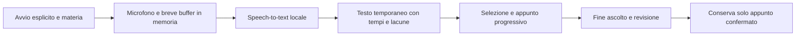

# Lezioni live → appunti per materia

[Indice](README.md) · [Piano](lezioni-live-ai/PLAN.md) · [Valutazione](lezioni-live-ai/EVALUATION.md) · [Fonti](lezioni-live-ai/SOURCES.md) · [Area di lavoro](../experiments/lecture-notes/README.md)

**10 ottobre 2026 — preparazione documentale, senza implementazione.** Prima sperimentazione su **notebook con Chrome, lezioni in italiano**, scelta confermata dall’utente. Nome di lavoro: **Appunti da lezione**. Nessun motore installato, modello scaricato, microfono attivato o benchmark eseguito in questa preparazione.

## Obiettivo e giudizio iniziale

Aprire iPagell durante una lezione, scegliere la materia, avviare l’ascolto e ottenere un appunto modificabile che conservi spiegazioni, esempi, domande utili e correzioni, riducendo conversazioni estranee. Alla fine resta soltanto l’appunto confermato dallo studente, senza un archivio della voce o della trascrizione integrale.

**L’idea merita una prova isolata.** La trascrizione italiana locale ha candidati concreti; l’utilità degli appunti in un’aula rumorosa rimane un’ipotesi. La difficoltà decisiva è conservare il senso della lezione quando il riconoscimento sbaglia, il docente cambia argomento o corregge quanto detto. Un modello speech-to-text riconosce parole: serve un passaggio distinto per selezionare e organizzare il contenuto.

La prima promessa da validare è «riduce il lavoro necessario per preparare appunti affidabili». Comprensione, memoria e risultati scolastici richiederebbero una ricerca successiva; non si deducono dalla qualità del riassunto.

## Perimetro della prima prova

| Incluso | Rimandato |
|---|---|
| Italiano, notebook Chrome, microfono integrato e confronto con microfono vicino alla voce | Telefoni, altre lingue, ascolto in background o a schermo bloccato |
| Una lezione e una materia scelte dall’utente | Classificazione automatica della materia e ricostruzione del corso |
| Trascrizione temporanea, appunto progressivo, pausa e conclusione | Registrazione riproducibile, archivio audio, trascrizione persistente |
| Revisione, modifica ed export locale del solo appunto finale | Sincronizzazione, pubblicazione in classe e inserimento automatico negli Appunti |
| Parlato, termini, numeri e formule pronunciate | Lettura della lavagna, immagini, OCR e formule mai espresse a voce |

Prima si usano contenuti sintetici e sessioni simulate con adulti informati. Una classe reale appartiene a una fase successiva, dopo verifica del trattamento dei dati e delle regole scolastiche.

## Tre problemi da provare separatamente

1. **Ascolto e trascrizione:** acquisizione continua, rumore, distanza, sovrapposizioni, parole tecniche, negazioni e numeri. Indicatore visibile quando la voce non è utilizzabile.
2. **Selezione:** distinguere spiegazione, esempio, domanda, correzione, compito e digressione. Un esempio apparentemente estraneo può essere essenziale alla materia; una domanda del compagno può chiarire il concetto.
3. **Appunto:** organizzare soltanto informazioni supportate, conservare le correzioni successive, segnalare dubbi e lacune; revisione dello studente prima di conservare il risultato.

Il rilevamento della voce può ridurre silenzi e rumore; non identifica chi parla e non riconosce le digressioni. La materia e un argomento facoltativo aiutano il contesto, senza autorizzare il modello a completare ciò che non ha sentito. Similarità semantica e sicurezza espressa dal modello non sono prove di pertinenza o correttezza.

## Direzione tecnica proposta

Il browser è il primo ambiente da qualificare. Un confronto nativo locale può diagnosticare un problema del runtime, ma non dimostra la fattibilità nella webapp. Motore di trascrizione e motore di appunti restano sostituibili e valutabili separatamente. ASR ha precedenza sulle elaborazioni testuali; la sintesi si aggiorna a intervalli sostenibili, senza avviare un generatore su ogni parola provvisoria.

**Ordine suggerito:** Whisper `base` multilingue come riferimento iniziale, `tiny` per misurare il compromesso; Vosk italiano piccolo come alternativa orientata allo streaming e al download ridotto. Runtime browser, conversioni, licenze e artefatti esatti devono essere qualificati prima del confronto. Moonshine rimane osservato: nel catalogo consultato non è elencato l’italiano. Dati pubblicati e limiti delle evidenze sono nel [registro delle fonti](lezioni-live-ai/SOURCES.md).

La generazione degli appunti parte da una baseline estrattiva: passaggi originali organizzati, senza riscrittura generativa. Soltanto dopo si confronta un generatore locale con la stessa trascrizione. Gli embedding si aggiungono se una prova dimostra un vantaggio; non sono un prerequisito. Nessun modello è scelto definitivamente in questa fase.

## Che cosa significa «l’audio non viene salvato»

La promessa proposta riguarda il **comportamento applicativo**, da dimostrare: niente file audio, scritture audio in IndexedDB/OPFS/cache, upload, backup, log o export. L’elaborazione richiede comunque brevi campioni in memoria. Non promettere assenza fisica di qualsiasi traccia nel sistema operativo, nella memoria gestita dal browser o in strumenti esterni di registrazione.

| Dato | Durante la lezione e la revisione | Dopo conferma o abbandono |
|---|---|---|
| Audio e copie nei worker | Solo memoria, finestra limitata e cancellazione dopo elaborazione | Nessuna copia conservata dall’app |
| Trascrizione, frammenti esclusi e riferimenti temporali | Solo memoria della sessione, consultabili per revisione testuale | Eliminati alla conferma/abbandono; mai allegati all’appunto |
| Appunto progressivo | In memoria, chiaramente provvisorio | Resta soltanto la versione esplicitamente confermata |
| Pesi e runtime | Download esplicito, cache separata | Ricostruibili e rimovibili; non contengono la lezione |
| Diagnostica | Tempi, contatori e codici di errore senza contenuto | Report locale esplicito; output testuali ammessi solo per fixture sintetiche |

Proposta iniziale: finestre audio fino a 30 secondi e **massimo 60 secondi di età per qualunque campione**, incluse code e copie nei worker. Al limite si interrompe l’acquisizione e si segnala una lacuna; non si accumula un’ora di audio. Sono parametri da congelare e provare, non capacità già implementate.

La pausa interrompe il microfono e scarta l’audio pendente. Fine interrompe subito l’acquisizione e permette di completare solo il lavoro già ricevuto entro il limite; Annulla termina i job e scarta i dati di sessione. Riprendere richiede un gesto esplicito. Ricarica, chiusura o crash possono perdere il lavoro non confermato: senza audio conservato non si può rielaborare la lezione né verificare una parola ascoltandola di nuovo. Un eventuale recupero delle sole bozze testuali sarebbe una decisione futura distinta dalla promessa iniziale.

Non usare la normale `SpeechRecognition` del browser presumendo che sia locale: alcuni percorsi inviano audio a servizi remoti. Le nuove capacità locali vanno provate per italiano/versione/dispositivo e devono fallire senza passaggio remoto. [Documentazione MDN](https://developer.mozilla.org/en-US/docs/Web/API/SpeechRecognition).

## Trattamento dei dati e aula reale

Elaborare localmente e conservare soltanto l’appunto riduce l’esposizione; non rende automaticamente lecito l’ascolto di altre persone. La nota stessa può contenere dati personali. Il permesso del browser riguarda il microfono del dispositivo, non l’autorizzazione degli interlocutori.

La giurisdizione della scuola non è stata indicata. In Svizzera l’IFPDT richiama LPD e Codice penale per ascolto/registrazione di conversazioni non pubbliche e consenso preventivo; in Italia il Garante distingue studio personale, disposizioni della scuola e altri usi o diffusione. Queste indicazioni non qualificano da sole il nuovo prodotto di trascrizione effimera. [IFPDT](https://www.edoeb.admin.ch/it/registrazione-di-conversazioni), [Garante, scuola](https://www.garanteprivacy.it/it/temi/scuola).

Prima del pilota reale: identificare paese/cantone e istituto, modalità d’uso individuale o servizio scolastico, soggetti coinvolti e minori, ruoli e base applicabile al trattamento; concordare informazione, possibilità di opposizione e pause. Verificare con il referente privacy della scuola anche l’eventuale sincronizzazione della nota. Il pilota non parte con una semplice casella «ho il consenso» come unica misura. Le simulazioni controllate possono proseguire indipendentemente.

Nella prima prova si evitano identificazione delle persone, impronte vocali e classificazione di emozioni. Eliminare dai risultati commenti personali e informazioni estranee è un obiettivo da testare; non garantisce anonimizzazione.

## Rapporto con iPagell e laboratorio precedente

| Riscontro nel codice letto | Implicazione |
|---|---|
| [Appunti](../hooks/use-notes.ts): `savePersonalDraft` persiste e chiama `queueSync`; `syncOne` invia alle API | Salvare nel writer attuale avvia la sincronizzazione di una nota valida. Il laboratorio deve evitarlo |
| [Storage](../lib/notes/storage.ts): `ipagell-notes-db`, chiavi per account, CAS | Non usare questo database per audio, trascrizioni o sessioni sperimentali |
| [Validazione](../lib/notes/validation.ts): `plain`/`md-lite-v1`, 20.000 code point, 65.536 byte | Futura copia del risultato tramite formato e limiti attuali; niente troncamento silenzioso |
| [Workspace](../components/ipagell-app.tsx): contesto materia e navigazione con `flushOpenNotes()` | Futuro ingresso dalla materia/Appunti, con ritorno coerente e stop dei job al cambio account |
| [Precache](../scripts/generate-precache.mjs): include JS/CSS/font dei chunk client ammessi | Un import differito non basta a tenere il runtime AI fuori dalla shell principale |
| [Studio L3](SPAZIO-STUDIO-AI-RIPRESA.md): generatore non qualificato e revisione umana aperta | Riutilizzare metodo e lezioni apprese; non assumere pronto un generatore né collegare i suoi archivi |

L’area `experiments/lecture-notes` oggi contiene solo istruzioni e regole di esclusione dei dati. Il futuro banco avrà origine/build/dipendenze propri, nessun account o database iPagell, nessun collegamento al laboratorio `study-local`. La separazione operativa non è ancora implementata o verificata.

Una futura integrazione parte da **appunto personale su richiesta**, revisione ed esplicita copia negli Appunti, con avviso sulla sincronizzazione nell’account. Condivisione in classe resta un gesto separato nel flusso esistente. Nessun nuovo percorso viene pubblicato prima dei criteri del [piano](lezioni-live-ai/PLAN.md). La produzione è `https://ipagell.website` tramite il progetto Sites esistente; il Worker sandbox non è questa produzione.

## Decisioni ancora aperte

- Dispositivo concreto, RAM, sistema operativo/versione Chrome e condizioni del microfono.
- Paese/cantone, istituto, livello scolastico e regole per il successivo pilota.
- Generatore locale capace di migliorare la baseline senza rallentare la trascrizione.
- Accettabilità della perdita del lavoro dopo crash rispetto alla conservazione della sola bozza testuale.

Questi punti non impediscono di preparare corpus sintetico e banco isolato. La prima attività successiva è **LN-01**, qualificazione dei runtime e predisposizione del protocollo; implementazione e ascolto non sono stati avviati da questo task.
