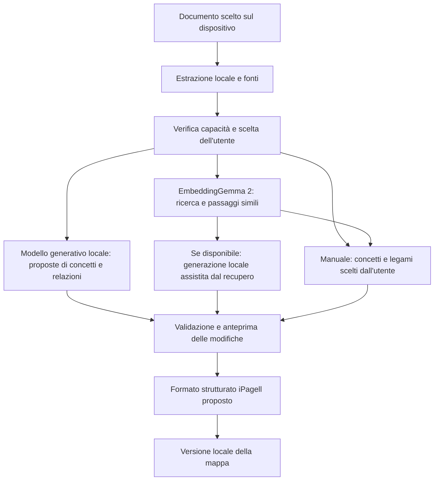

# Spazio Studio — fattibilità dell'elaborazione locale

[Indice](README.md) · [Proposta originaria](SPAZIO-STUDIO-AI.md) · [Considerazioni](SPAZIO-STUDIO-AI-CONSIDERAZIONI.md) · [Prompt di lavoro](SPAZIO-STUDIO-AI-PROMPTS.md) · [Preparazione L0](SPAZIO-STUDIO-AI-L0.md)

**7 ottobre 2026. Fattibilità documentata e laboratorio L1 isolato implementato; nessuna funzione pubblicata.**
La [preparazione L0](SPAZIO-STUDIO-AI-L0.md) fissa confini e protocollo. Il successivo
[rapporto L1](SPAZIO-STUDIO-AI-L1.md) registra estrazione/fonti, baseline e prova reale del
Text 270M con runtime npm fissato. Il risultato sintetico non basta a qualificare distribuzione,
precisione, memoria, offline o telefoni. L2 è implementato nel [rapporto dedicato](SPAZIO-STUDIO-AI-L2.md). Dall’8 ottobre il [banco L3](SPAZIO-STUDIO-AI-L3.md) è implementato, ma nessun generatore è qualificato; accettazione e L4 restano sospesi. Le sezioni sotto conservano
l'analisi iniziale e vanno lette insieme ai riscontri successivi.

## Mandato e decisioni dell'utente

Trasformare documenti scolastici in una mappa personale per materia, dando priorità all'esecuzione sul dispositivo dell'utente. Le prime analisi e i prompt sono stati seguiti dalla preparazione L0, richiesta prima dell'implementazione.

Decisione esplicita: quando il dispositivo non sostiene il modello, **restare sul dispositivo con modalità manuale o semplificata**. Il cloud è una possibile evoluzione separata, senza passaggio automatico. Un errore, una risposta scadente o l'assenza di WebGPU non autorizzano l'invio dei materiali a un servizio remoto.

## Qual è il nuovo modello

La novità ufficiale più plausibilmente associata al riferimento «nuovo Gemma 2» è **EmbeddingGemma 2, annunciato il 6 ottobre 2026**. È un modello di embedding: trasforma contenuti in vettori per ricerca e confronto. L'associazione con il nome usato dall'utente è un'inferenza dagli annunci, non una conferma del nome da parte dell'utente. [Annuncio Google](https://blog.google/innovation-and-ai/technology/developers-tools/embeddinggemma-2/)

| Nome | Distinzione utile per questo progetto |
|---|---|
| Gemma 2 | Famiglia generativa del 2024, nei tagli 2B, 9B e 27B. Non corrisponde ai tagli 1B/4B dello schema iniziale. [Release ufficiali](https://ai.google.dev/gemma/docs/releases) |
| Gemma 3 | Famiglia generativa con varianti 1B e 4B, coerenti con quello schema; resta da provare il checkpoint nel runtime scelto. [Model card](https://ai.google.dev/gemma/docs/core/model_card_3) |
| T5Gemma 2 | Famiglia encoder-decoder annunciata il 18 dicembre 2025; l'annuncio rilascia checkpoint preaddestrati, non instruction-tuned. Non è intercambiabile con un modello pronto a seguire il prompt della mappa. [Annuncio](https://blog.google/innovation-and-ai/technology/developers-tools/t5gemma-2/) |
| EmbeddingGemma 2 | Nuova uscita del 6 ottobre 2026, da valutare per ricerca locale, raggruppamenti e recupero dei concetti candidati. Non genera sintesi o JSON della mappa. [Documentazione](https://ai.google.dev/gemma/docs/embeddinggemma) |
| Gemma 4 E2B / E4B | Candidati generativi presenti nella documentazione web attuale di LiteRT-LM. I parametri effettivi indicati dalla sigla non equivalgono alla memoria necessaria. [API web](https://developers.google.com/edge/litert-lm/js), [panoramica modelli](https://ai.google.dev/gemma/docs/core) |

**Conseguenza:** separare motore di ricerca e motore generativo. Il nuovo embedding può rendere più accessibile una parte dello Spazio Studio; la generazione automatica della mappa richiede un altro modello oppure il lavoro manuale dell'utente.

## Cosa era già stato analizzato

Letti `AGENTS.md`, snapshot, architettura corrente, matrice di verifica, proposta AI, tutte le considerazioni AI, piano prodotto e riferimenti pertinenti della ricerca e del programma UX. La ricerca trasversale non ha individuato una precedente scelta Gemma o un runtime AI locale.

| Proposta precedente | Esito del confronto con l'esecuzione locale |
|---|---|
| Spazio personale per materia, grafo interno e albero leggibile | Da mantenere. Il motore AI non determina la struttura del prodotto. |
| Fonti per concetti, identificatori stabili, diff e rollback | Da mantenere anche senza server. La validazione precede il salvataggio della versione. |
| Documento originale, estratti, derivati e stato personale separati | Da mantenere in archivi locali separati logicamente e isolati per account. |
| Upload protetto, object storage, D1, coda e indice vettoriale remoto | Erano una proposta per elaborazione remota; non sono prerequisiti della prova locale. |
| Astrazione del fornitore AI | Da mantenere come adattatori separati per estrazione, embedding e generazione. |
| PDF/DOCX/PPTX/TXT/Markdown, poi OCR | Ridurre la prima prova a testo e PDF digitali. Gli altri parser e l'OCR richiedono prove specifiche. |
| Ricerca, chat e collaborazione nelle fasi successive | La ricerca locale può essere anticipata come esperimento; non trascina con sé chat o collaborazione. |
| Stato di apprendimento scelto dallo studente | Da mantenere. Una mappa generata non attesta apprendimento. |

Fonti interne: [proposta AI](SPAZIO-STUDIO-AI.md), [considerazioni](SPAZIO-STUDIO-AI-CONSIDERAZIONI.md), [roadmap](PRODOTTO.md), [ricerca prodotto](../research/PRODUCT-INTELLIGENCE-2026-09-23.md). La direzione visiva resta nel [programma next gen](NEXTGEN-2026-10-02.md); questo documento non apre una riprogettazione concorrente dell'interfaccia.

## Riscontro nel codice attuale

| Area verificata | Cosa esiste e cosa implica |
|---|---|
| [Manifest](../package.json), [schema](../db/schema.ts), [tipi diario](../types/domain.ts) | Nessun runtime Gemma/embedding o schema Spazio Studio. Materiali e mappe devono avere un percorso distinto da `SchoolData`. |
| [Formato note](../lib/notes/format.ts), [validazione](../lib/notes/validation.ts) | Solo `plain` e `md-lite-v1`; limite 20.000 code point e 64 KiB serializzati. Non è un formato per grafi. |
| [Controller Appunti](../hooks/use-notes.ts), [storage](../lib/notes/storage.ts) | Appunti personali con IndexedDB, outbox e sincronizzazione automatica. Riutilizzare quel salvataggio invierebbe il risultato al server. |
| [Export PDF](../lib/notes/pdf.ts) | Produce PDF da note; non implementa l'importazione o l'estrazione delle dispense. |
| [Workspace](../components/ipagell-app.tsx), [vista Appunti](../components/notes-view.tsx) | Ingressi per materia già presenti; l'integrazione va progettata conservando contesto e flush dell'editor. |
| [Service worker](../public/sw.js), [precache](../scripts/generate-precache.mjs) | Cache della shell con allowlist, non gestione dei pesi. La generazione include JS/CSS/font dei chunk client anche se caricati in modo differito; il runtime AI richiede una decisione esplicita anche sul precache. |

L'ispezione del codice conferma il confine riportato nello [snapshot](REPO-SNAPSHOT.md): lo Spazio Studio è progettato ma non implementato. Il checkout contiene molte modifiche preesistenti, da conservare. Nessuna verifica della produzione è stata eseguita in questa analisi.

## Flusso proposto e capacità progressive

| Modalità | Risultato utile | Limite |
|---|---|---|
| Manuale, senza modelli | Testo consultabile, concetti e relazioni creati dall'utente | Niente sintesi automatica; se il parser fallisce, offrire testo incollato. |
| Solo embedding | Ricerca semantica e passaggi candidati da collegare | La mappa si costruisce con conferma/manualmente; similarità non prova identità, prerequisito o causa. |
| Solo generazione | Proposta di mappa da sezioni del documento | Per piccoli corpus gli embedding possono essere superflui; qualità e memoria da misurare. |
| Embedding e generazione | Recupero dei candidati esistenti e proposta di aggiornamento incrementale | Valutare caricamento sequenziale dei motori per ridurre il picco di memoria. |

Tutte le modalità convergono sullo stesso formato. L'alternativa manuale deve permettere di lavorare, conservare ed esportare la mappa anche quando non si scarica alcun modello.

Per aggiornare il corso, analizzare tutte le sezioni leggibili del nuovo documento, con avanzamento e segnalazione delle sezioni escluse. Il recupero dei migliori passaggi serve a confrontare il nuovo materiale con quello esistente; non deve eliminare dall'analisi i nuovi argomenti solo perché non somigliano ai precedenti.

## Fattibilità e limiti decisivi

**Giudizio preliminare:** fattibile come esperimento locale per testo, ricerca semantica e mappa verificabile. Non è ancora dimostrato che la generazione automatica sia utilizzabile su tutta la platea mobile di iPagell.

| Aspetto | Evidenza disponibile | Decisione proposta |
|---|---|---|
| Embedding nel browser | Google documenta `EmbeddingEngine` in JavaScript e un artefatto LiteRT-LM. È supporto documentato, non una prova con Vinext/iPagell. [Guida](https://developers.google.com/edge/litert-lm/embedding_models) | Prima prova isolata di embedding e ricerca locale. |
| Impronta del modello | Google distingue 270M parametri per testo e 740M con tutti gli encoder. L0 ha individuato la [conversione dedicata al testo](https://huggingface.co/litert-community/embeddinggemma-2-text-270m-litert-lm/tree/main), dichiarata da 165 MB; questo non è il consumo totale del browser. | Primo candidato 270M, senza scaricare la variante multimodale da 485 MB. Compatibilità web, byte, tokenizer e memoria da provare con runtime fissato, come nel rapporto L0. |
| Generazione web | LiteRT-LM documenta Gemma 4 E2B/E4B; la vecchia API MediaPipe LLM è in manutenzione e indirizza alla migrazione. [API web](https://developers.google.com/edge/litert-lm/js), [avviso MediaPipe](https://developers.google.com/edge/mediapipe/solutions/genai/llm_inference/web_js) | Valutare LiteRT-LM per primo. Confrontare 1B/4B soltanto con una combinazione checkpoint/runtime verificata, senza imporre il nome dello schema iniziale. |
| Capacità del dispositivo | `deviceMemory` è approssimativo e non universalmente disponibile; `requestAdapter()` può non fornire un adattatore. [Memoria](https://developer.mozilla.org/en-US/docs/Web/API/Navigator/deviceMemory), [WebGPU](https://developer.mozilla.org/en-US/docs/Web/API/GPU/requestAdapter) | Usare feature detection e prova breve, senza soglie arbitrarie di RAM o deduzioni dal nome del dispositivo. Assenza di un segnale significa capacità sconosciuta. |
| Storage e offline | Quota stimata e persistenza sono API diverse; la persistenza può non essere concessa. [Stima](https://developer.mozilla.org/en-US/docs/Web/API/StorageManager/estimate), [Persistenza](https://developer.mozilla.org/en-US/docs/Web/API/StorageManager/persist) | Download su scelta esplicita, controllo integrità, spazio e rimozione. Offline soltanto dopo cache verificata di app, runtime, tokenizer e pesi. |
| PDF e scansioni | PDF.js espone estrazione testuale per pagina; questa non equivale a OCR o comprensione affidabile di formule e tabelle. [API PDF.js](https://mozilla.github.io/pdf.js/api/draft/module-pdfjsLib-PDFPageProxy.html) | Provare PDF digitali; conservare pagina e passaggi. Segnalare pagine vuote e ordine di lettura ambiguo. |

La model card di EmbeddingGemma 2 prescrive attenzione alla precisione numerica, ai prefissi di task e alla normalizzazione dopo riduzione dimensionale. Segnala problemi con float16. Inoltre gli esempi di prefisso nella model card e nella guida LiteRT-LM consultate non coincidono: prima del benchmark va verificato il trattamento previsto dall'artefatto effettivo, senza combinare esempi di runtime diversi. [Model card Google](https://huggingface.co/google/embeddinggemma-2), [guida runtime](https://developers.google.com/edge/litert-lm/embedding_models). L0 registra la discrepanza e il protocollo di confronto; non dichiara ancora risolto il contratto dei prefissi.

## Confini di dati, download e persistenza

1. **Elaborazione locale:** documento, estratti, embedding e mappa restano sul dispositivo per impostazione iniziale. Nessun contenuto nei log o nella telemetria.
2. **Download dei modelli:** può richiedere rete e un host di distribuzione; questo è distinto dall'invio delle dispense. Mostrare dimensione reale e origine prima del download. Distribuzione dei pesi, licenza e eventuali condizioni di accesso vanno verificate per ogni artefatto scelto.
3. **Archivio dello studio:** percorso locale separato dagli Appunti sincronizzati, con chiavi per account, gestione concorrenza, export/import e cancellazione. I pesi sono cache riutilizzabile; le mappe sono lavoro dell'utente e richiedono protezione diversa.
4. **Copia negli Appunti:** eventuale comando esplicito che mostra che la copia verrà sincronizzata con l'account. Non presentare quel risultato come esclusivamente locale. Non riscrivere l'outbox esistente per questo esperimento.
5. **Logout, cambio account e cancellazione:** invalidare risultati pendenti, rilasciare il motore e impedire accesso incrociato. Definire rimozione/conservazione degli archivi locali anche per dispositivi offline: una cancellazione server non raggiunge automaticamente copie di altri dispositivi.
6. **Backup:** il V3 corrente non include mappe o documenti. Prima distribuzione dello Spazio Studio: export/import locale dedicato e verificato; un'estensione del backup generale richiede un contratto versionato successivo. I pesi scaricabili non entrano nei backup utente.

Per il prototipo non sono necessari nuovi endpoint, tabelle D1, R2 o code server. Le autorizzazioni server restano necessarie per qualunque futura sincronizzazione o condivisione. L'esecuzione locale non protegge da altri script della stessa origine: non introdurre script terzi capaci di leggere i materiali.

## Cosa significa «formato iPagell»

Il contratto versionato `study-graph-v1` è ora implementato nel [laboratorio L2](SPAZIO-STUDIO-AI-L2.md). Non inserire JSON della mappa in `md-lite-v1` e non chiedere al modello di produrre HTML, SVG o codice da eseguire.

| Parte | Contenuto minimo |
|---|---|
| Spazio | ID, account locale, materia e lingua del materiale |
| Documenti e sezioni | ID, hash, versione estrattore, testo immutabile dei chunk e pagina/sezione |
| Concetti | ID stabile assegnato dall'app, titolo, sintesi, fonti, origine manuale/generata |
| Relazioni | Origine, destinazione, tipo ammesso e fonti; distinzione tra gerarchia e legami trasversali |
| Stato personale | Note e apprendimento scelto dall'utente, separati dalla proposta AI |
| Versioni | Revisione di base, diff, commit atomico, operazione annullabile e metadati della pipeline |

Il modello restituisce soltanto una proposta con ID temporanei. L'app verifica schema chiuso, limiti, riferimenti esistenti, fonti, archi e assenza di cicli nella gerarchia; assegna gli ID definitivi e richiede revisione del diff. Le fonti puntano al testo estratto immutabile; gli offset, se usati, devono avere unità definite nel contratto.

Un riferimento che esiste prova la rintracciabilità, non la correttezza della sintesi. Il supporto semantico richiede valutazione sul corpus e revisione. Nessuna unione automatica di concetti solo per vicinanza dei vettori. La rimozione di una fonte aggiorna anche versioni ed evidenze; un concetto con altre fonti non va eliminato automaticamente.

## Prova necessaria prima di scegliere i modelli

Corpus iniziale: 10–20 documenti sintetici o autorizzati, più materie, italiano e campioni de/fr/en, lezioni successive, concetti omonimi, negazioni/contraddizioni, PDF con colonne, formule/tabelle e scansioni da riconoscere come non supportate.

| Prova | Risultato da registrare |
|---|---|
| Ricerca testuale semplice contro EmbeddingGemma 2 | Qualità del recupero su domande annotate, latenza e utilità effettiva; evitare un modello se non migliora il caso reale. |
| Generazione senza/con recupero | Concetti importanti recuperati, sintesi supportate, duplicati, relazioni errate e costo in tempo/memoria. |
| Compatibilità | Browser/versione/OS/device reali, caricamento, dimensione download, primo risultato e durata totale. Emulazione mobile non prova il dispositivo. |
| Risorse | Picco di memoria quando misurabile, stima separata quando non lo è, UI responsiva, perdita GPU, tab in background e pressione storage. |
| Affidabilità | Annullamento, timeout, riapertura offline, download interrotto, doppia scheda, cambio account e commit incompleto. |
| Controllo dell'utente | Fonte apribile, diff comprensibile, annullamento, export/import e modalità manuale sempre accessibili. |

Vincoli iniziali: nessun invio dei contenuti durante elaborazione locale; nessun output non valido applicato; tutte le fonti della proposta accettata risolvibili; nessuna perdita dello stato personale. Concordare e registrare nel protocollo, prima di confrontare i candidati, le soglie di qualità semantica, tempi e dimensioni accettabili. Non chiamare la funzione pronta usando soltanto esempi riusciti o benchmark del produttore.

## Sequenza di coordinamento

| Passo | Consegna | Condizione per procedere |
|---|---|---|
| L0 — fattibilità operativa | Versioni/artefatti verificati, confini del prototipo e protocollo | Distinguere supporto documentato da prove; nessuna promessa mobile universale. |
| L1 — prova embedding | Estrazione testuale, ricerca locale e confronto con baseline | Recupero utile, risorse accettabili e nessun invio materiali. |
| L2 — contratto della mappa | Schema, fonti, revisioni, import/export e percorso manuale | La mappa funziona anche senza AI. |
| L3 — prova generativa | Proposte su sezioni, confronto dei candidati e validazione | Qualità semantica e risorse soddisfano il protocollo. |
| L4 — integrazione personale | Flusso per materia, persistenza, download, recovery e lingue | Tutti i percorsi concordati verificati, compresa alternativa manuale. |

I [prompt operativi](SPAZIO-STUDIO-AI-PROMPTS.md) traducono questi passi in incarichi separati. La loro presenza non avvia implementazione, download, deleghe o pubblicazione.

## Verifiche dell'analisi iniziale

- Letti documenti precedenti e implementazione dei confini rilevanti; consultate fonti Google, Google AI Edge, model card Google e API browser/PDF.js il 7 ottobre 2026.
- Nessuna esecuzione dei modelli, installazione di dipendenze, modifica del runtime, accesso ai materiali utente o deploy.
- `npm run docs:check` superato: inventario allineato, 51 documenti e 417 collegamenti locali verificati. `git diff --check` superato. Questi controlli non certificano compatibilità, memoria o qualità dei modelli.

Per la preparazione successiva leggere il [rapporto L0](SPAZIO-STUDIO-AI-L0.md) e la [matrice aggiornata](VERIFICATION-MATRIX.md#spazio-studio-l0--7-ottobre-2026); i conteggi sopra descrivono soltanto l'analisi iniziale.
