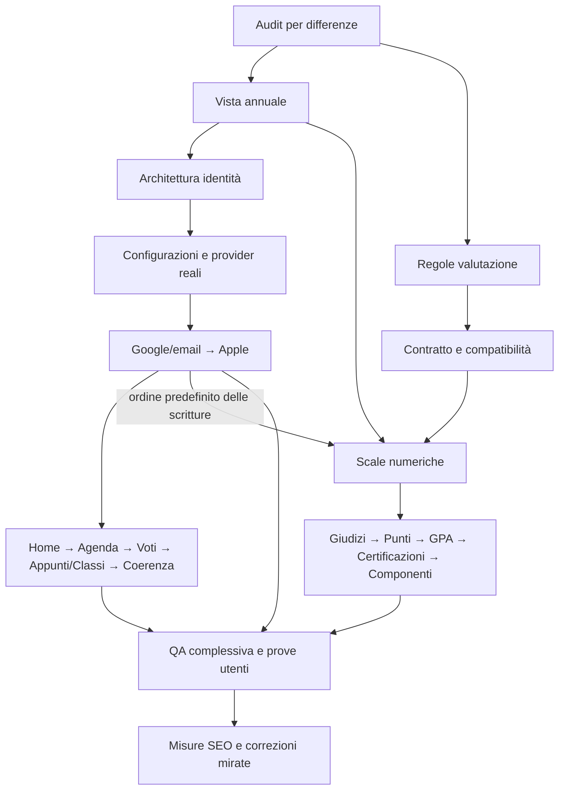

# Workflow completo e modelli per iPagell

Piano operativo del **1 ottobre 2026**, fuso Europe/Zurich. [Programma](PLAN.md) · [14 prompt](PROMPTS.md) · [Evidenze](VERIFICATION.md)

## Perimetro e stato

Questo workflow copre tutto il programma richiesto: ingresso e SEO, comprensione del prodotto, registrazione standard, Home/Agenda/Voti/Appunti/Classi, coerenza estetica, andamento annuale e altri sistemi di valutazione. Il primo ciclo ingresso/SEO/setup è già pubblicato in Sites 28. PERIODS-01/W1 è ora implementato nel checkout e in verifica/pubblicazione; il registro finale distingue questi passaggi. Gli audit iniziali e l’analisi multi-sistema esistono: aggiornarli per differenze, senza rifarli automaticamente.

È organizzazione del lavoro futuro, non avvio automatico degli incarichi o modifica dei modelli delle chat. AI per lo studio, OCR, chat, annunci/file e push a sito chiuso appartengono a roadmap separate; non vengono aggiunti al perimetro di questo programma. Prestazioni, offline, backup e prove fisiche restano verifiche trasversali, secondo la matrice repository.

## Modelli verificati e criterio di scelta

Documentazione ufficiale consultata il 1 ottobre 2026. La pagina [Models](https://developers.openai.com/api/docs/models) presenta Astra per il lavoro più complesso, Sol per l’equilibrio qualità/costo e Luna per compiti circoscritti ad alto volume. Le assegnazioni a iPagell sotto sono **raccomandazioni operative**, non benchmark misurati sulla repository.

| Nome nel piano | ID esatto | Impiego consigliato | Reasoning iniziale |
|---|---|---|---|
| Sol | `gpt-6.1-sol` | Responsabile del ciclo, codice, UX, ricerca e verifiche ordinarie | `medium` per audit/procedure; `high` per implementazioni |
| Astra | `gpt-6-astra` | Identità, modello dati, migrazioni, policy matematiche e revisione dei rischi più complessi | `high` per decisioni critiche; `medium` per revisioni circoscritte |
| Luna | `gpt-6-luna` | Inventari, estrazione da fonti fornite, confronti di cataloghi e riepiloghi strutturati | `high` per compiti limitati; risultato verificato dal responsabile |

Sol e Astra supportano `low`, `medium`, `high`, `xhigh`, `max`; Luna supporta anche `none`. Sono capacità API documentate, non disponibilità garantita in ogni account. [Sol](https://developers.openai.com/api/docs/models/gpt-6.1-sol), [Astra](https://developers.openai.com/api/docs/models/gpt-6-astra), [Luna](https://developers.openai.com/api/docs/models/gpt-6-luna).

La [documentazione Codex](https://learn.chatgpt.com/docs/models) distingue disponibilità per account/client e selezione nel model picker. I tre ID sono anche esposti fra i modelli di questa sessione; questo non certifica limiti residui né accesso di un altro account. Scegliere modello e reasoning nel selettore, o tramite parametro supportato quando si delega. Scrivere il nome nel prompt non cambia da solo il modello. Non cambiare configurazioni globali per seguire questa tabella.

Per l’API usare le opzioni supportate dalla scheda del modello; non tradurre automaticamente Ultra in un valore API. Il workflow usa `medium`/`high`; `xhigh` o `max` soltanto per un problema concreto dove una prova comparativa giustifica maggior lavoro. La qualità finale dipende da fonti, esecuzione e verifiche, non dal solo effort. [Guida reasoning](https://developers.openai.com/api/docs/guides/reasoning).

Se Sol 6.1 non è disponibile, usare il Sol accessibile nel client per lavoro ordinario e Astra, se disponibile, per attività critiche; ricontrollare la sua scheda, senza trasferire prezzi o parametri da un altro modello. Non fare migrazioni o linking di account affidandone la verifica finale a un estrattore Luna. Non sono necessari modelli audio, immagini generate o modelli cyber specialistici per questo piano; l’audit visivo deve vedere il prodotto reale.

## Modello per ciascuno dei 14 prompt

La revisione è una lettura fresca di requisiti, sorgente/diff ed evidenze; il nome diverso del modello non garantisce indipendenza. Per lavoro critico usare un reviewer separato dal writer. Per cambi piccoli bastano controlli proporzionati, senza imporre una seconda analisi completa.

| Prompt | Responsabile e reasoning | Supporto / revisione | Deliverable e dipendenza |
|---|---|---|---|
| 01 — SEO tecnico | Sol `medium` | Luna per inventario URL; Sol `high` per anomalie SSR | Audit aggiornato per differenze, fonti Google e backlog; Search Console quando accessibile |
| 02 — Visivo/accessibilità | Sol `high` | Sol in lettura fresca con browser/screenshot e contrasti | Rapporto visivo con prove reali, non dedotto solo dal CSS |
| 03 — Prodotto/primo valore | Sol `high` | Astra `medium` solo per scelte trasversali irrisolte | Journey e priorità; test con persone quando disponibili |
| 04 — Architettura identità | Astra `high` | Reviewer fresco Astra `high` | Contratto, migrazioni proposte e configurazioni mancanti prima di 05 |
| 05 — Implementazione identità | Sol `high` | Astra `high` su linking, sessioni, migrazione e recovery | Patch dopo 04; provider reali/configurati e QA 07 prima del deploy |
| 06 — UX per cicli | Sol `high` | QA Sol; Astra se cambia persistenza/concorrenza | Un ciclo A/B/C/D/E alla volta; prima leggere le evidenze esistenti |
| 07 — QA prodotto | Sol `high` | Astra `high` per auth/dati, solo quando coinvolti | Journey, rete, responsive, regressioni e cleanup sul diff finale |
| 08 — Deploy e SEO esterna | Sol `medium` | Sol `high` per errori di build/publish | Sorgente esatto, Sites succeeded, dominio; nessun deploy da una sola build |
| 09 — Vista annuale | Sol `high` | Astra `medium` per pesi/aggregazioni | Materia continua, filtro separato dalle scritture; QA 07 → 08 |
| 10 — Ricerca valutazioni | Sol `medium` | Luna estrae regole da fonti; Astra `medium` risolve ambiguità | Catalogo ristretto verificato e regole mancanti per 11 |
| 11 — Dati/compatibilità | Astra `high` | Reviewer fresco Astra `high` | Contratto e piano antidowngrade/migrazione/backup dopo 10, prima di 12 |
| 12 — Scale numeriche | Sol `high` | Astra `high` per formato, medie e client vecchi | Primo gruppo di profili dopo 11; QA 14 → 08 |
| 13 — Metodi complessi | Astra `high` per regole; Sol `high` per implementare | Astra `high` sul contratto/policy del ciclo scelto | A giudizi, B punti, C GPA, D certificazioni, E componenti; QA 14 per ciascuno |
| 14 — QA multi-sistema | Astra `high` | Sol esegue suite/journey; reviewer valuta le prove | Migrazione, import, offline, zero, scale incompatibili e storico prima di 08 |

Non far implementare 05 e 12 insieme nello stesso checkout: entrambi modificano contratti, storage o schema. La ricerca 10 e la progettazione 04 possono invece procedere in sola lettura durante un ciclo UI, con conclusioni rilette prima della patch.

## Sequenza completa e previsione del lavoro

Una **sessione** qui è un’unità di lavoro guidata con obiettivo circoscritto e risultato registrato; può richiedere più turni, attese o riprese. Non è una previsione dei minuti di esecuzione del modello. Le quantità sono stime iniziali di pianificazione dell’autore, non tempi OpenAI o consuntivi. Ogni intervallo include implementazione e controlli pertinenti; i cicli applicativi includono anche preparazione/publicazione. Rifare la stima dopo i primi due cicli usando i risultati effettivi.

| Passo | Lavoro e risultato atteso | Prompt | Precondizione | Sessioni stimate |
|---|---|---|---|---|
| W0 | Audit aggiornati e backlog unico; eventuale ritocco ingresso da evidenza | 01–03, 06 se serve patch | Sorgente e stato attuali, audit già disponibili | 1–2 |
| W1 | Materia continua e andamento annuale, senza migrazione della scala | 09 → 07 → 08 | W0; numeric-1-6 corrente | 2–3 |
| W7 | Architettura Google/email/Apple e elenco preciso delle configurazioni | 04 | Ricerca esistente; può partire in lettura durante W1–W6 | 1–2 |
| W8 | Google/email verificata, collegamento legacy e recovery | 05 → 07 → 08 | W7 e configurazioni Google/email/segreti effettive | 3–5 |
| W9 | Apple funzionante e verificato | 05, ciclo Apple → 07 → 08 | W7/W8, requisiti Apple Developer/app/Services ID e callback risolti | 2–4 |
| W2 | Home/prima materia e primo risultato più diretti | 06 A → 07 → 08 | W1; architettura W7 e patch account chiusa o bloccata per configurazione | 1–2 |
| W3 | Agenda più comprensibile, filtri e ritorni conservati | 06 B → 07 → 08 | W2 | 1–2 |
| W4 | Voti: input, pesi, statistiche e simulazioni coerenti | 06 C → 07 → 08 | W1/W3; evitare duplicazione del lavoro annuale | 1–2 |
| W5 | Appunti e Classi: ricerca, privato/condiviso e contesto; conservare autosave | 06 D → 07 → 08 | W2–W4 | 2–3 |
| W6 | Coerenza generale di palette, disposizione, testi, focus e mobile | 06 E + 02 → 07 → 08 | W2–W5; controlli estetici anche nei cicli precedenti | 1–2 |
| W10 | Primo catalogo di valutazioni e regole verificabili | 10 | Analisi esistente; può procedere in lettura durante UX/account | 1–2 |
| W11 | Contratto multi-sistema e migrazione compatibile | 11 | W10; rilettura di eventuali modifiche account già integrate | 1–2 |
| W12 | Prime scale numeriche complete nel diario e strumenti pertinenti | 12 → 14 → 08 | W11, dopo la chiusura di eventuale patch account | 3–5 |
| W13 | Cinque famiglie del prompt 13, in sottocicli separati | 13 A–E → 14 → 08 per ciclo | W12; regole specifiche e input reali verificati | 8–16 |
| W14 | Journey complessivo, device fisici/PWA e recupero; risolvere regressioni | 07 + 14; 08 se patch | Evidenze dei cicli, dispositivi e piano di recupero disponibili | 2–3 |
| W15 | SEO misurata e prova di comprensione con nuovi utenti | 01 + 03 + parte esterna 08 | Search Console autorizzata e partecipanti | 1–2 + osservazione nel tempo |

**Totale senza W13: 23–41 sessioni. Totale con tutti i sottocicli W13: 31–57 sessioni.** Con un ritmo ipotetico di 3–4 sessioni chiuse alla settimana: circa **6–14 settimane** per la base e **8–19 settimane** includendo tutte le famiglie complesse. A 1–2 sessioni/settimana il calendario cresce proporzionalmente. Non sono date promesse; conteggio prudenziale sequenziale, prima di benefici da parallelismo o nuovi problemi.

Le attese per credenziali, revisione provider, requisiti Apple, disponibilità dei dispositivi/utenti e dati Search Console sono escluse dal totale e possono estendere il calendario. W13 può richiedere un’ulteriore suddivisione se le regole di un istituto o certificazione sono incomplete: completare un profilo non equivale a coprire tutti gli istituti del mondo. In W15 raccogliere prima una baseline e confrontarla dopo più settimane; nessun termine garantito per indicizzazione o ranking.

## Dipendenze e parallelismo

La freccia Google/email/Apple → scale numeriche indica un ordine operativo delle patch, non una dipendenza tecnica dei voti dall’accesso social. Se i provider sono in attesa, chiudere la patch account e proseguire prima con W2–W6, poi W10–W12 su un checkout stabile; riprendere W8/W9 quando configurabili. Non lasciare una patch auth incompleta mescolata alla migrazione voti.

Team massimo previsto per un ciclo: responsabile Sol che integra, ricercatore in sola lettura, reviewer in sola lettura, QA dopo la patch stabile. Questa sessione dispone di quattro slot complessivi, incluso il responsabile; non assumere quattro subagenti oltre al responsabile. Non occorre usare tutti gli slot per ogni task. Un solo writer nel checkout condiviso e un solo owner di browser/DB sintetico durante le prove. Nessun comando deploy o test mutante mentre un altro agente modifica il medesimo sorgente.

## Cosa chiude davvero un ciclo

1. Identificare problema, file reali, criterio d’accettazione e ciò che è già risolto. Input: piano, audit pertinente e commit attuale.
2. Implementare la patch circoscritta, mantenendo dati e invarianti. Il responsabile integra le conclusioni dei ricercatori.
3. Rivedere il diff e correggere problemi riproducibili. Per auth/formati/migrazioni serve la revisione dedicata prevista sopra.
4. Eseguire `npm run check`; per un rilascio `npm run release:prepare` comprende anche build/precache. Suite API/browser solo dove pertinenti, con utenti sintetici e cleanup. Test precedenti non sono prove dei nuovi cambiamenti.
5. Aggiornare guide, changelog e rapporto: passato/fallito/non eseguito, limiti, screenshot e dipendenze concrete.
6. Prompt 08: sorgente esatto, versione Sites salvata, deployment `succeeded`, dominio canonico ipagell.website e configurazione preservata. Per task soltanto documentali/di ricerca registrare il risultato senza deploy.
7. Registrare il prossimo ciclo e l’eventuale dipendenza esterna. Se c’è una dipendenza, continuare con lavoro indipendente, senza dichiarare completo quel deliverable.

## Costi: API e Codex sono conti distinti

Per svolgere questo piano in Codex non serve aggiungere l’API OpenAI al software iPagell. Nessuna chiamata API o acquisto è avviato da questo documento. Le tariffe per token API non rappresentano il costo o il consumo del tuo abbonamento Codex; l’accesso e le modalità di utilizzo dipendono dal piano/client. [Modelli in Codex](https://learn.chatgpt.com/docs/models).

Solo se in futuro si esegue lo stesso workflow tramite API, le tariffe Standard pubblicate per contesto corto sono:

| Modello | Input per 1M token | Output per 1M token |
|---|---|---|
| gpt-6.1-sol | USD 2 | USD 10 |
| gpt-6-astra | USD 10 | USD 50 |
| gpt-6-luna | USD 0,10 | USD 0,50 |

Tariffe verificate il 1 ottobre 2026; contesto lungo e altre modalità hanno prezzi diversi. [Pricing ufficiale](https://developers.openai.com/api/docs/pricing). I token di reasoning sono fatturati come output; il testo visibile da solo non misura il costo. [Reasoning e usage](https://developers.openai.com/api/docs/guides/reasoning).

Scenari **ipotetici**, non consumo previsto/misurato di iPagell: ripartire sia input sia output per 70% Sol, 20% Astra, 10% Luna dà tariffe medie USD 3,41/M input e USD 17,05/M output. Per richieste nel livello di contesto corto, senza cache, tool, altre modalità, tasse o costi provider:

| Scenario illustrativo | Input totale | Output totale, reasoning incluso | Costo aritmetico |
|---|---|---|---|
| Contenuto | 5M | 1M | USD 34,10 |
| Intermedio | 20M | 4M | USD 136,40 |
| Intensivo | 50M | 10M | USD 341,00 |

Questi importi non sono un preventivo dell’intero progetto: mancano misure del consumo per ciclo. Ridurre contesti duplicati e delegazioni inutili; dopo W0/W1 misurare usage per modello e aggiornare gli scenari. Non presentare prezzi API come conversione delle percentuali o dei crediti Codex.

## Avvio pratico e registro

Selezione proposta iniziale: **GPT-6.1 Sol, high**, per il responsabile del programma. Primo incarico: W0, aggiornamento mirato degli audit 01–03 usando i documenti esistenti; poi W1/prompt 09 con QA e deploy. Le scelte di modello qui non avviano quelle attività da sole.

Per ogni ciclo registrare: ID W/ciclo, prompt, modello ed effort effettivi, commit di partenza, file toccati, criterio d’accettazione, stato, prove/limiti, versione/deployment se applicabile, consuntivo delle sessioni e prossimo passo. Stati del ciclo: pianificato / in corso / bloccato / completato. Registrare separatamente implementazione, verifica e pubblicazione; «verificato» e «pubblicato» sono evidenze, non scorciatoie per completato. Non segnare pubblicato un documento, una build o un push.

Stato alla creazione: primo ciclo Sites 28 pubblicato; analisi e 14 prompt disponibili, passi futuri pianificati. Il registro sotto aggiorna questa fotografia; non la usare per ignorare lavoro già iniziato. Gli ID W sono stabili e non rappresentano più l’ordine numerico di esecuzione: la tabella segue annuale → architettura/account → UX, come richiesto dal proprietario.

### Registro PERIODS-01 / W1

1 ottobre 2026, una sessione circoscritta, prompt 09 → verifiche pertinenti 07 → pubblicazione 08. Stato **in corso**. Partenza `a1ebee6`, produzione iniziale Sites 28; responsabile nel modello della chat senza cambio delle impostazioni. Supporto effettivo: `gpt-6.1-sol` high (UI, sola lettura e revisione), `gpt-6-astra` medium (pesi/aggregazioni, sola lettura e revisione); entrambi disponibili, nessuna delegazione della scrittura o del browser.

File coinvolti: helper grade-scope, filtro UI, workspace/Voti, StatsView, EntryDialog, calculations, quattro cataloghi, CSS, test semantici e guide. Nessun contratto persistente, API, schema o binding modificato. Criteri: media 4,5 fra due periodi, anno/storico/archiviati, ID distinti, corrente vuoto, destinazione reale e contesto conservato. Evidenze/commit/versione/deployment e limiti nel [rapporto](VERIFICATION.md). Prossimo ciclo: **W7 / prompt 04**, poi Google/email e Apple soltanto quando configurabili.
