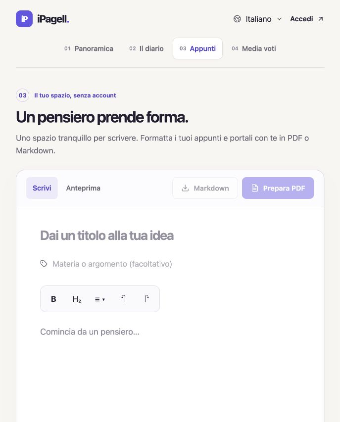

# Appunti iPagell: scrivere per materia, riordinare, ripassare

Analisi del 21 ottobre 2026. Nessuna implementazione applicativa, installazione di dipendenze o pubblicazione. Questo documento propone una direzione e il lavoro necessario per validarla; non modifica le specifiche del prodotto corrente.

## 1. Obiettivo e informazioni raccolte

L'utente chiede di migliorare l'intero percorso **lezione → riordino → ripasso**, preparando prima ricerca e ingegnerizzazione e lasciando il codice a una fase successiva. Ha poi indicato difficoltà concrete: **mastrini di contabilità, strumenti per matematica e altre materie, indentazione, colori e forme**.

Questa precisazione cambia la priorità: il primo problema da risolvere è riuscire a rappresentare il contenuto della lezione con poco sforzo. Riordino e ripasso devono poi utilizzare quelle rappresentazioni. Una funzione di ripasso sarebbe poco utile se lo studente non riuscisse a scrivere correttamente l'esercizio.

**Direzione raccomandata:** un quaderno ordinato in pagine, con testo e blocchi specifici inseribili al bisogno; strumenti essenziali sempre riconoscibili, strumenti della materia disponibili su richiesta. La scelta della materia suggerisce strumenti, senza limitare quelli utilizzabili. Mastrini e formule restano oggetti modificabili, esportabili e comprensibili anche fuori dall'editor.

L'utente ha successivamente fornito una schermata di un proprio appunto di contabilità: il caso concreto è analizzato nella sezione 4.1. Non è ancora dimostrato quale soluzione sia più veloce per l'utente: mancano l'osservazione della scrittura, la conferma del dispositivo principale, un esempio matematico e una prova comparativa. La lista di funzioni seguente è una proposta da validare, non una domanda di mercato già misurata.

## 2. Base verificata in iPagell

Letti [AGENTS.md](../../AGENTS.md), [snapshot](../../docs/REPO-SNAPSHOT.md), [architettura](../../docs/ARCHITECTURE-CURRENT.md), [matrice delle verifiche](../../docs/VERIFICATION-MATRIX.md), specifiche Appunti/editor e skill locale [apple-design](../../.agents/skills/apple-design/SKILL.md). Le affermazioni sotto sono state confrontate con il codice corrente del checkout, che contiene già molte modifiche preesistenti.

| Area | Riscontro nel codice | Conseguenza progettuale |
| --- | --- | --- |
| Editor | [note-editor.tsx](../../components/note-editor.tsx): ProseMirror, paragrafi, un livello di titolo, grassetto, liste e a-capo | Esiste un motore estensibile da valutare prima di sostituirlo |
| Indentazione | Ogni elemento di lista contiene un solo paragrafo; [editor-selection.ts](../../lib/notes/editor-selection.ts) documenta esplicitamente il vincolo | Le liste annidate richiedono schema, comandi e serializzazione coerenti; non basta un pulsante |
| Formato | [format.ts](../../lib/notes/format.ts): solo `plain` e `md-lite-v1`; nessun nodo per tabelle, matematica, forme o colori | Un contenuto ricco non può essere conservato fedelmente nel contratto attuale |
| Lettura ed export | [note-content.tsx](../../components/note-content.tsx) e [pdf.ts](../../lib/notes/pdf.ts) interpretano lo stesso insieme ristretto | Ogni nuovo oggetto va progettato anche per lettore, anteprima, ricerca e PDF |
| Organizzazione | [notes-view.tsx](../../components/notes-view.tsx): materia, ricerca nel titolo/testo visibile, pin, recenti; [related-notes.tsx](../../components/related-notes.tsx) raggruppa per materia | La relazione per materia esiste; non equivale a collegamenti per concetto o percorso di studio |
| Agenda | [ipagell-app.tsx](../../components/ipagell-app.tsx): ingresso negli appunti con materia e contesto di ritorno | Esiste navigazione contestuale, ma non una relazione persistente fra singola verifica e insieme di appunti |
| Persistenza | [use-notes.ts](../../hooks/use-notes.ts), storage e riconciliazione: bozza locale, outbox personale, revisione e conflitti | Preservare le protezioni; una nota personale valida viene avviata alla sincronizzazione dal writer corrente |
| Classe | Bozza privata e pubblicazione esplicita; copie indipendenti | Il lavoro personale e gli esiti di ripasso non devono diventare condivisi implicitamente |
| Limiti | [validation.ts](../../lib/notes/validation.ts): 20.000 code point serializzati e 65.536 byte per nota | Con un nuovo formato occorrono budget distinti per testo, struttura, profondità e oggetti |
| Backup | [backup.ts](../../lib/notes/backup.ts): V3, import e rimappatura degli ID | Nuovo contenuto o metadati richiedono un piano di compatibilità e ripristino completo |
| Foglio pubblico | [public-notes.tsx](../../components/public-notes.tsx): stesso editor, singola bozza separata, locale | Non confondere questa superficie con gli appunti dell'account |

Il limite attuale non dimostra un limite di ProseMirror: deriva anche dallo schema scelto da iPagell e dalle trasformazioni verso il formato persistito. Un cambio di libreria, da solo, non risolverebbe il contratto dei dati.

### Osservazione visuale limitata

Flusso osservato nell'anteprima locale già esistente, senza creare account: foglio pubblico, scrittura di testo sintetico e anteprima. Gli screenshot sono stati acquisiti e riaperti in questa sessione. La superficie privata è stata analizzata nel codice; non è stata sottoposta a un nuovo audit visuale autenticato. Le immagini non rappresentano una nuova verifica della produzione.

| Passo | Stato osservato | Valutazione e limite |
| --- | --- | --- |
| 1. Aprire il foglio vuoto | Titolo, materia facoltativa, toolbar breve, area di scrittura | Ingresso essenziale. Gli strumenti visibili coprono testo semplice; nessun inserimento di mastrino, formula o tabella |
| 2. Scrivere | Testo sintetico inserito; stato passato da salvataggio a bozza salvata nel browser | Il percorso di scrittura di base è disponibile. Non misura velocità in aula né comportamento con tastiera virtuale |
| 3. Aprire l'anteprima | Il contenuto viene presentato per la lettura | Separazione scrittura/lettura chiara nel caso osservato. Nessun percorso di esercitazione in questa superficie |

Accessibilità: i controlli osservati espongono nomi nell'albero di accessibilità, ma questo non certifica uso con lettori di schermo. Tastiera completa, contrasto misurato, dispositivi fisici, zoom al 200%, temi e quattro lingue non sono stati nuovamente verificati qui. Nuovi colori e oggetti interattivi dovranno entrare esplicitamente in quelle prove.

## 3. Ricerca esterna: cosa trasferire e cosa non dedurre

Fonti primarie consultate il 21 ottobre 2026. La documentazione dei prodotti descrive possibilità, non prova benefici per gli utenti di iPagell.

| Fonte | Informazione utile | Applicazione proposta |
| --- | --- | --- |
| [OpenStax, registrazioni e T-accounts](https://openstax.org/books/principles-financial-accounting/pages/3-5-use-journal-entries-to-record-transactions-and-post-to-t-accounts) | La rappresentazione distingue conto, lato Dare/Avere, movimenti e saldo | Un mastrino deve conservare queste relazioni come dati, evitando allineamenti costruiti con spazi |
| [ProseMirror, modulo tabelle](https://github.com/ProseMirror/prosemirror-tables/blob/master/README.md) | Esistono nodi, comandi e plugin dedicati alle tabelle | Studiare l'estensione del motore presente. Una tabella generica può essere un primo oggetto, ma non comprende automaticamente il significato di un mastrino |
| [MathLive, tastiera matematica](https://mathlive.io/mathfield/guides/virtual-keyboard/) | Input matematico visuale e tastiere configurabili | Candidato per inserire frazioni, esponenti e simboli senza imporre conoscenza di LaTeX; da qualificare su selezione, mobile, licenza/versione e PDF |
| [KaTeX, opzioni](https://katex.org/docs/options) e [sicurezza](https://katex.org/docs/security) | Rendering matematico, output HTML/MathML e opzioni di fiducia | Candidato di rendering; non sostituisce un editor visuale né garantisce automaticamente un export PDF corretto |
| [Microsoft, modelli OneNote](https://support.microsoft.com/en-us/onenote/apply-a-onenote-template-to-a-page) | Layout e contenuti iniziali riutilizzabili | Modelli facoltativi di lezione/esercizio possono ridurre il lavoro ripetuto; non devono riscrivere una pagina già compilata |
| [Cornell, metodo degli appunti](https://lsc.cornell.edu/notes.html) | Distingue annotazione, formulazione di domande, richiamo, riflessione e revisione | Separare i momenti del percorso. Non imporre una pagina a colonne o un unico metodo a tutte le materie |
| [Dunlosky et al., 2013](https://www.psychologicalscience.org/journals/pspi/1529100612453266/) | La rassegna attribuisce alta utilità generale a practice testing e distributed practice | Progettare in seguito esercitazione e riprese nel tempo; la letteratura non dimostra l'efficacia di una specifica UI iPagell |
| [RemNote, flashcard](https://help.remnote.com/en/articles/8663109-flashcard-basics) e [preparazione esami](https://help.remnote.com/en/articles/9101991-preparing-for-an-exam) | Appunti collegati alla pratica e organizzazione rispetto a una data | Osservare la continuità fra materiale e ripasso. Non assumere che ogni esercizio debba diventare una flashcard |

**Inferenza di progetto:** il contenuto dovrebbe restare nello stesso percorso quando cambia attività: scrivere il mastrino, correggerlo, nascondere alcuni dati per esercitarsi e rivedere gli errori. Questa continuità è un'ipotesi da mettere alla prova, non un risultato della ricerca citata.

## 4. Ricerca utente da completare prima della specifica definitiva

Il messaggio sui mastrini è un requisito concreto; «colori» e «forme» descrivono invece anche soluzioni possibili. Occorre capire quale compito devono servire: evidenziare una correzione, distinguere categorie, collegare passaggi, disegnare geometria o riprodurre uno schema alla lavagna.

Prima raccolta proposta: una sessione con l'utente su tre compiti brevi, utilizzando materiale didattico senza dati personali. Chiedere di mostrare il risultato desiderato, riprodurlo con il metodo attuale e spiegare cosa rende difficile modificarlo o studiarlo. Non serve registrare l'audio per svolgere questa osservazione.

| Compito | Cosa osservare | Informazione da ricavare |
| --- | --- | --- |
| Contabilità: due mastrini e alcuni movimenti | Tempo per disegnare, inserire valori, correggere, aggiungere un conto e mantenere l'allineamento | Se basta una struttura T o servono registrazioni collegate, riferimenti e saldi |
| Matematica: una frazione, una potenza, tre passaggi e una spiegazione | Passaggio testo/formula, modifica di un simbolo, allineamento dei passaggi | Frequenza dei simboli, necessità di input visuale, grafici o geometria |
| Appunto discorsivo: tre livelli, evidenziazione e collegamento | Indentare/rientrare, correggere la gerarchia, significato del colore e della freccia | Differenza fra struttura del documento, stile e disegno |

Raccogliere anche dispositivo, tastiera o penna, metodo attuale, durata delle lezioni e uso su telefono durante il ripasso. Non assumere che notebook/italiano, citati in una ricerca precedente, siano la scelta esclusiva per questo nuovo progetto.

Un piccolo secondo gruppo di studenti con modalità diverse servirebbe a cercare casi che smentiscono la proposta; non sarebbe un campione statistico. La raccolta va conclusa con una matrice problema → frequenza osservata → gravità → soluzione candidata → evidenza mancante.

### 4.1 Caso concreto fornito: registrazioni, confronto e calcoli nella stessa pagina

Evidenza: screenshot allegato dall'utente nella conversazione, successivo alla prima analisi. La parte visibile contiene un confronto fra due metodi di contabilizzazione, spiegazioni sintetiche, righe contabili disposte in colonne con separatori, un'operazione rappresentata su due righe, una nota laterale collegata da una freccia, un riepilogo di valori e un rapporto accompagnato da spiegazione e conversione percentuale. La seconda sezione prosegue oltre il bordo inferiore della schermata: non è stata osservata per intero. Non sono stati letti il record originale o la sequenza di editing; non si può stabilire dalla sola immagine se l'allineamento sia stato ottenuto con spazi, tabulazioni o incolla.

Il caso rende prioritaria anche la **registrazione contabile a colonne**, distinta dal mastrino a T. Entrambi possono essere necessari nello stesso quaderno. Una registrazione può occupare più righe mantenendo un unico nome dell'operazione e una spiegazione comune. Non va modellata come una lista di paragrafi indipendenti o come un'immagine.

| Evidenza visibile | Bisogno ricavato | Requisito candidato e verifica |
| --- | --- | --- |
| Nomi dei conti, indicazioni intermedie e importi disposti su colonne | Separare i campi dal loro allineamento grafico | R01: blocco di registrazioni con colonne reali; allungare un nome non deve spostare le colonne delle altre righe |
| Un'operazione occupa due righe di conti e importi | Conservare l'appartenenza a un'unica operazione | R02: gruppo di righe con etichetta e commento comuni; inserire, spostare o duplicare il gruppo deve conservare la relazione |
| Segni prima/dopo i nomi dei conti e un'indicazione centrale | Rispettare le convenzioni della lezione | R03: etichette e simboli modificabili; significato da confermare prima di introdurre interpretazioni o controlli automatici |
| Freccia e annotazione a lato di una registrazione | Collegare una spiegazione al passaggio pertinente | R04: nota associata a riga/gruppo, presentabile lateralmente su desktop e vicino alla sorgente su mobile; il legame resta dopo il riordino |
| Grandezze e risultati riepilogati in verticale | Allineare nome e valore senza impaginazione manuale | R05: piccolo riepilogo a due colonne, con etichette e valori selezionabili e modificabili separatamente |
| Rapporto numerico, spiegazione in parole e risultato percentuale | Mescolare linguaggio matematico e testo | R06: formula in linea o a blocco con passaggi allineati; supporto della spiegazione vicina, senza imporre un risolutore |
| Due sezioni dedicate a metodi diversi | Confrontare esempi senza perdere la gerarchia della pagina | R07: titoli e gruppi ordinati; modello facoltativo per il confronto, senza obbligo di affiancamento |

**Priorità rivista sul caso osservato:** colonne e gruppi di registrazioni, annotazioni collegate e riepiloghi entrano nel primo confronto progettuale insieme a rientri e formattazione. Mastrini e formule restano prove specifiche, ma una prima versione solo con mastrini non coprirebbe questo appunto.

**Ipotesi di interazione da verificare:** dopo aver inserito una registrazione, lo studente compila i campi passando fra celle; può aggiungere una seconda riga alla stessa operazione e associare una spiegazione. La disposizione viene mantenuta dall'oggetto durante scrittura, riapertura e PDF. Su schermo stretto i legami fra colonne devono restare espliciti: confrontare scorrimento orizzontale del solo blocco e una vista di dettaglio etichettata, senza ridurre l'intera pagina o cambiare silenziosamente l'ordine dei campi.

La schermata rafforza l'ipotesi di una pagina a flusso con oggetti strutturati: qui la relazione spaziale principale è fra righe, colonne e note associate. Non dimostra ancora un bisogno di tela libera. Colori e forme restano richieste dell'utente, ma il loro uso concreto non è documentato da questa immagine.

Prima della specifica, chiarire soltanto ciò che manca nel caso: significato delle indicazioni fra i conti, convenzioni da conservare, comportamento desiderato quando si aggiunge una riga e utilità o meno dei calcoli automatici. I valori e le abbreviazioni dell'appunto non vengono reinterpretati come regole contabili dal sistema proposto.

## 5. Sistema funzionale proposto

### 5.1 Base comune di scrittura

Priorità iniziale per tutti: titoli gerarchici, liste realmente annidate, aumenta/riduci rientro, evidenziazione e colori controllati, tabelle semplici, annulla/ripeti e inserimento riconoscibile di oggetti. Rientro di un paragrafo e profondità di una lista sono operazioni diverse e devono essere comprensibili.

I colori hanno una palette leggibile nei temi esistenti; il colore originale scelto resta memorizzato come token stabile, con resa adattata al tema. Per significati come «dubbio» o «correzione» serve anche un'etichetta, così che stampa in grigio e visione dei colori diversa non eliminino l'informazione. La palette è facoltativa e non obbliga uno schema personale di studio.

Tab e Shift+Tab possono modificare il livello in un elenco, con comportamento esplicito; devono restare disponibili comandi visibili e un modo prevedibile per uscire dall'editor. In una tabella, Tab può passare alla cella successiva. Queste regole vanno progettate insieme, comprese selezioni multiple e tastiere mobili.

### 5.2 Contabilità: registrazioni e mastrini come oggetti distinti

Il caso fornito introduce un primo oggetto di registrazione con colonne configurate sul metodo didattico effettivo, gruppi di righe, importi e annotazioni associate. Una tabella generica è una base trasversale utile; il modello contabile aggiunge relazioni e comandi specifici. Nel primo perimetro evitare celle unite arbitrarie e impaginazione libera se non servono ai compiti osservati.

Inserisci mastrino crea titolo del conto e due lati etichettati Dare/Avere, con movimenti modificabili e ordine stabile. Data/riferimento e descrizione breve sono campi da confermare con l'utente. Più mastrini possono formare un gruppo che su schermo largo li affianca e su schermo stretto conserva un ordine di lettura esplicito.

Il saldo automatico è un'evoluzione separata: se incluso, deve essere chiaramente derivato dai movimenti e indicare il lato. Gli importi vanno trattati con precisione decimale definita e parsing locale esplicito, senza arrotondamenti accidentali. Un mastrino isolato non può certificare che una registrazione in partita doppia sia corretta.

Per il primo perimetro eviterei classificazione automatica dei conti, esercizi autocorretti e contabilità completa. Il valore da dimostrare è poter riportare e correggere rapidamente ciò che viene spiegato. Le convenzioni effettivamente usate a scuola vanno raccolte prima di congelare il modello.

### 5.3 Matematica: scrittura visuale e passaggi

Inserisci formula deve funzionare sia in linea col testo sia come blocco. Primo insieme candidato: frazioni, potenze, radici, parentesi e simboli comuni. L'utente può modificare visivamente; un ingresso LaTeX può essere aggiuntivo, senza diventare un prerequisito.

Un esercizio può associare consegna, passaggi ordinati, spiegazioni e risultato separato. La formula memorizza una rappresentazione modificabile; un'immagine della formula da sola non basta. Grafici di funzione, geometria e risoluzione automatica sono capacità distinte, con bisogno di dati e verifiche propri.

### 5.4 Forme e schemi

Distinguere tre bisogni: riquadro attorno a un concetto, freccia fra due elementi, disegno libero. I primi due possono partire da blocchi o piccoli diagrammi incorporati. Il terzo richiede una superficie di disegno, gestione penna/tocco, zoom, selezione e alternative accessibili.

Raccomandazione iniziale: pagina a flusso con diagrammi incorporati, da confrontare con una tela libera usando gli stessi compiti. Una tela libera può diventare prioritaria se l'osservazione mostra scrittura a mano o organizzazione spaziale continua. Non è una decisione da chiudere sulla sola parola «forme».

### 5.5 Riordino e ripasso

Al termine della lezione, proporre senza obbligo: sistemare il titolo/argomento, raccogliere i dubbi, distinguere esempio e regola, collegare un esercizio alla verifica pertinente. Le operazioni conservano sempre originale e possibilità di annullamento.

Per il ripasso: domanda con risposta nascosta per definizioni; consegna con soluzione separata per matematica; esercizio con movimenti o importi nascosti per contabilità. La modalità esercizio usa una copia o uno stato di sessione, così le risposte dello studente non sovrascrivono l'appunto sorgente.

Una proposta come «Riprendi questo esercizio: lo hai segnato difficile» deve mostrare il motivo, poter essere rimandata e non creare automaticamente attività. Esito dell'esercizio, autovalutazione e stato di sincronizzazione sono tre informazioni differenti. La prima versione può usare una data scelta dall'utente; un algoritmo adattivo richiede una valutazione successiva.

## 6. Ingegnerizzazione: decisioni prima del codice

### 6.1 Separare documento, strumenti e percorso personale

| Livello | Responsabilità | Esempi |
| --- | --- | --- |
| Documento | Contenuto autorevole e ordinamento degli oggetti | Paragrafo, elenco annidato, formula, registrazione contabile, mastrino, diagramma |
| Strumenti | Comandi e interazioni sul contenuto | Inserisci frazione, aggiungi movimento, cambia livello, scegli colore |
| Percorso personale | Organizzazione e attività di studio | Data lezione, argomento, dubbio, collegamento alla verifica, tentativo di ripasso |
| Derivati | Rappresentazioni ricostruibili | Estratto per ricerca, PDF, anteprima, suggerimenti |

Ogni oggetto strutturato ha identità stabile e versione del proprio schema. Un blocco mastrino conserva conti e movimenti, non coordinate di testo usate per simulare colonne. Un diagramma conserva elementi e relazioni, oltre alla disposizione. Gli ID consentono collegamenti futuri, ma richiedono regole per duplicazione, import e cancellazione.

Per le registrazioni, servono identità di gruppo/riga e un riferimento stabile dell'annotazione al proprio bersaglio. Duplicare un gruppo assegna nuovi ID e rimappa i collegamenti interni; cancellarlo deve gestire esplicitamente la nota associata. La posizione laterale del commento è una scelta di visualizzazione, mentre il legame alla riga è parte dei dati. Non introdurre un sistema generale di commenti collaborativi per soddisfare questa necessità personale.

### 6.2 Formato persistito

| Strategia | Beneficio | Limite | Giudizio iniziale |
| --- | --- | --- | --- |
| Continuare con `md-lite-v1` invariato | Minore lavoro immediato | Non rappresenta fedelmente i nuovi oggetti | Adatto soltanto a prove di contenuti testuali |
| Aggiungere convenzioni testuali e markup custom | Sembra vicino al formato presente | Parser fragile, riferimenti instabili, conversioni ambigue | Da evitare come fondamento dei blocchi disciplinari |
| Introdurre un documento strutturato versionato | Oggetti tipizzati, gerarchia, conversioni controllate | Richiede intervento coerente sull'intero percorso dei dati | Direzione raccomandata da specificare |
| Conservare HTML arbitrario | Ampia resa immediata | Difficile validare, normalizzare e mantenere coerente con PDF | Non coerente con i confini attuali |

Il nome e lo schema definitivo del nuovo formato restano da decidere. Un documento JSON chiuso è una possibilità concreta; `content` potrebbe inizialmente rimanere una stringa contenente il documento serializzato, ma vanno verificati costi, byte e migrazioni. Riutilizzare la colonna non equivale a mantenere la compatibilità.

Per ogni tipo di nodo servono: campi ammessi, limiti, validazione, migrazione, rendering, testo per ricerca, copia/incolla, export e comportamento se non supportato. Non aggiungere capacità cambiando il significato di `md-lite-v1` sotto lo stesso identificatore.

Le note `plain` e `md-lite-v1` restano leggibili. La conversione va provata senza perdita e resa esplicita al primo uso di capacità nuove, con percorso di recupero. Un vecchio client deve essere bloccato prima di poter riscrivere una nota che non comprende: il fallback testuale del lettore attuale, da solo, non è una strategia di compatibilità sufficiente.

### 6.3 Motore e dipendenze

Prima opzione da valutare: estendere ProseMirror, già presente, con schema e comandi adatti. Tabelle e liste vanno qualificate sullo schema concreto di iPagell. MathLive e KaTeX sono candidati per ruoli diversi, non dipendenze già selezionate. Non c'è evidenza raccolta che giustifichi oggi una riscrittura con un altro editor.

Il collegamento fra editor matematico e cronologia del documento è una decisione delicata: annullamento locale della formula e annullamento dell'appunto non devono contraddirsi. Lo stesso vale per tabelle, diagrammi, composizione IME e cambio focus.

Prima di qualsiasi scelta: verificare versione/licenza, bundle effettivo, supporto ai browser, accessibilità, offline e resa PDF. Il [precache corrente](../../scripts/generate-precache.mjs) include gli asset JS/CSS/font ammessi: un import differito non garantisce da solo di evitare il download nella shell offline.

### 6.4 Persistenza e compatibilità

Conservare la sequenza commit locale → conferma locale → sincronizzazione → conferma account, con revisioni e conflitti. L'aggiunta di un blocco deve entrare nella stessa unità di salvataggio del documento: non mostrare un mastrino salvato se si è conservato soltanto il testo circostante.

Nel primo perimetro il documento può restare l'unità di conflitto. Co-scrittura e merge per blocco non sono richiesti e introdurrebbero una complessità separata. Gli ID dei blocchi non obbligano a una persistenza remota per blocco.

I metadati di studio e i tentativi richiedono un contratto dedicato; non inserirli nel JSON del diario senza progettare la convivenza con il suo salvataggio a snapshot. Una domanda o un esercizio derivato mantiene riferimento alla sorgente e alla sua versione. Se la sorgente cambia, il materiale va segnalato da ricontrollare; un cambio di pin non deve simulare una modifica didattica.

Backup, import e copie personali/classe devono preservare gli oggetti supportati e rimappare gli ID correlati. La nuova versione del backup va progettata esplicitamente; quella attuale non comprende questi dati. Stato personale e tentativi restano esclusi dalla pubblicazione in classe salvo una scelta distinta e intenzionale.

### 6.5 Export e limiti

Il PDF è parte della funzione: mastrini con lati e importi leggibili, formule complete, liste annidate e colori distinguibili anche in grigio. Bisogna decidere impaginazione e divisione di tabelle/oggetti fra pagine. Il generatore attuale lavora su testo e liste: visualizzare correttamente nel browser non prova che l'export sia pronto.

Markdown può conservare testo e alcune strutture, ma non promettere fedeltà a mastrini, colori o diagrammi. Un export con perdita deve dichiararlo; il backup strutturato resta il percorso di ripristino. Evitare che la sola rasterizzazione diventi l'unica copia recuperabile di una formula o tabella.

Nuovi budget da definire su esempi realistici: byte del documento, numero di blocchi, profondità, dimensione tabelle, movimenti per mastrino, lunghezza/complessità delle formule e oggetti dei diagrammi. Non aumentare indiscriminatamente i 20.000 caratteri attuali per compensare la struttura.

## 7. Applicazione concreta a iPagell

| Punto attuale | Evoluzione candidata | Vincolo da mantenere |
| --- | --- | --- |
| Nuovo appunto dalla materia | Pagina con inserimento generale e suggerimenti della materia | Si può sempre scrivere subito, senza configurare un progetto |
| Toolbar condivisa | Base comune breve e inserimento contestuale di oggetti | Focus, selezione, annulla/ripeti, comandi visibili e traduzioni |
| Lettore condiviso | Stessa interpretazione dei nuovi blocchi di personale, classe e anteprima | Nessuna resa diversa dei dati fra editor e lettore |
| Elenco e correlati | Data lezione/argomento facoltativi e collegamenti espliciti successivi | Non scambiare stessa materia per pertinenza certa |
| Agenda | Selezione degli appunti/esercizi da preparare per una verifica | Il collegamento non completa o modifica la verifica |
| Home | Una ripresa contestuale motivata, solo se utile | Nessuna dashboard aggiuntiva obbligatoria o pressione a completare tutto |
| Foglio pubblico | Supporto compatibile del documento quando il nuovo formato è pronto | Storage e comunicazione distinti dall'account |
| Classe | Pubblicazione dei blocchi confermati con anteprima fedele | Bozza privata e gesto esplicito di condivisione |

File certamente coinvolti in una futura implementazione: editor, selezione, formato/validazione, lettore, PDF, tipi, API/repository note, schema/migrazioni, storage/riconciliazione, backup e cataloghi i18n. Le viste Appunti/pubblica/classe devono essere incluse perché condividono il motore. Questo elenco descrive il perimetro da specificare, non autorizza modifiche in questa fase.

## 8. Ordine di lavoro e criteri per proseguire

| Fase | Consegna prima di procedere | Criterio di passaggio |
| --- | --- | --- |
| A. Raccolta mirata | Tre esempi di appunti e osservazione dei compiti, dispositivo e convenzioni disciplinari | Problemi ordinati per evidenza; significato di «forme» chiarito |
| B. Requisiti e alternative | Flussi descritti e confronto pagina strutturata/tela sui compiti rilevanti | Perimetro iniziale scelto e motivato, inclusi casi esclusi |
| C. Architettura e contratti | Modello del documento, oggetti, migrazioni, compatibilità, budget ed export | Ogni oggetto ha percorso completo di salvataggio, lettura e recupero |
| D. Validazione dell'interazione | Successiva prova di modelli visuali/interattivi sui medesimi compiti | Meno passaggi di impaginazione e nessuna perdita di informazioni rispetto al metodo attuale |
| E. Consegna per implementazione | Specifiche, task dipendenti, esempi di input/output e criteri di accettazione | Chi implementa non deve inventare le regole dei dati o del comportamento |
| F. Sviluppo successivo | Implementazione incrementale e verifiche appropriate | Compatibilità e casi reali dimostrati; pubblicazione come fase distinta |

**Sequenza candidata delle capacità, rivista dopo lo screenshot:** base di scrittura e struttura → caso contabile osservato (registrazioni, annotazioni e riepilogo), mastrini e formule come prove specifiche → forme/diagrammi secondo la ricerca → riordino ed esercitazione. Ogni prova deve comprendere riapertura, sincronizzazione, lettura e PDF. Il formato comune va pensato per questi oggetti anche se la prima consegna implementata dovesse riguardarne uno solo.

L'AI può in seguito proporre domande, riordino o passaggi da chiarire con riferimenti alla sorgente e conferma dell'utente. Non è un prerequisito per risolvere i problemi espressi. Il [laboratorio Studio](../../docs/SPAZIO-STUDIO-AI-RIPRESA.md) non ha qualificato un generatore per l'integrazione; [Appunti da lezione](../../docs/LEZIONI-LIVE-AI.md) è preparazione documentale. Questi percorsi restano separati da questa proposta e non vanno presentati come capacità pronte.

## 9. Verifiche da progettare nella consegna tecnica

| Scenario | Risultato richiesto |
| --- | --- |
| Elenco con più livelli, rientro/uscita e annullamento | Gerarchia e testo conservati dopo salvataggio e riapertura |
| Registrazione su più righe, conto lungo e annotazione collegata | Colonne e appartenenza all'operazione conservate; la nota segue la sorgente dopo riordino, duplicazione ed export |
| Mastrino con modifica, inserimento e rimozione di movimenti | Nessuno scambio Dare/Avere; dati allineati anche in PDF |
| Formula fra testo e liste, modifica interna e annullamento | Sorgente modificabile, focus prevedibile e nessuna duplicazione |
| Colori in chiaro/scuro e stampa in grigio | Contenuto leggibile e significato non affidato al solo colore |
| Oggetto lungo o oltre i limiti | Rifiuto comprensibile senza troncamento e con recupero del lavoro |
| Offline, risposta persa, due schede, conflitto e cambio account | Protezioni attuali conservate per l'intero documento |
| Client precedente e nota nel nuovo formato | Nessuna riscrittura distruttiva o perdita per conversione implicita |
| Backup/import con blocchi e metadati collegati | Recupero fedele e rimappatura dei riferimenti |
| Copia/pubblicazione in classe | Oggetti conservati, tentativi e stato personale esclusi |
| Mobile fisico, IME, tastiera e lettore di schermo | Inserimento e uscita dagli oggetti usabili senza dipendere da hover/drag |

Misurare sui compiti: completamento, tempo, interventi di allineamento manuale, errori non recuperati e corrispondenza dopo export. Le soglie si fissano dopo la baseline e prima del confronto. Per il ripasso, una prova successiva deve distinguere facilità percepita, risposta immediata e prestazione differita; più tempo trascorso nell'app o una pagina più colorata non dimostrano apprendimento.

## 10. Stato della consegna

Completati: lettura delle istruzioni e della documentazione di contesto, verifica mirata dell'implementazione, osservazione limitata dell'editor pubblico locale, ricerca primaria e proposta di sistema con perimetro tecnico e criteri di passaggio. Il successivo screenshot dell'utente è stato analizzato come caso concreto e ha aggiornato le priorità della proposta.

Da completare con l'utente: esempio matematico, dispositivo e metodo di scrittura, convenzioni delle registrazioni, granularità dei mastrini e significato delle forme. Da svolgere successivamente: prova comparativa, selezione definitiva delle dipendenze, specifiche esecutive e implementazione.

Prodotti soltanto questo documento e tre screenshot. Non sono stati modificati file applicativi, avviati ascolti, scaricati modelli o pubblicato il sito. Le verifiche applicative storiche citate nella repository non sono state rieseguite né presentate come esiti di questa analisi.
